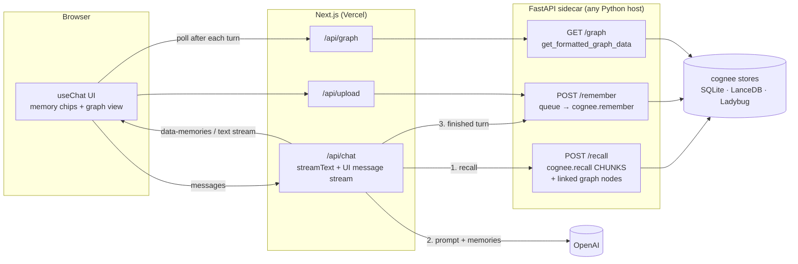

# Next.js + Vercel AI SDK chat with cognee memory

A Next.js (App Router) chat template that gives a Vercel AI SDK chatbot long-term memory through [cognee](https://github.com/topoteretes/cognee). Before each answer the route recalls relevant memories from cognee and adds them to the prompt. After each answer the finished turn goes back into cognee's knowledge graph. The UI shows which memories an answer used and draws the graph as it grows.

> Author: Hamroz Gavharov. This is a community template, not an official cognee package.

**Why this integration:** [cognee-integrations](https://github.com/topoteretes/cognee-integrations) covers Python agent frameworks, Mastra, OpenClaw, n8n, Dify, Claude Code, Codex and chat bots. Its `integrations/inventory.yml` lists a "Cognee for Vercel AI SDK" entry as `migration_status: pending`, and the source repo it names was not publicly reachable on 2026-11-16. As far as I could find, there is no public Next.js / Vercel AI SDK template, so this one aims to fill that gap.

## What it shows

| Feature | Where |
| --- | --- |
| Recall before answering: `cognee.recall(query, query_type=CHUNKS)`, with results injected into the system prompt as data, not instructions | `src/app/api/chat/route.ts`, `sidecar/app.py` `/recall` |
| Write after each turn: `cognee.remember(turn)` (add + cognify) through a serial write queue, so a chat reply never waits on cognify | `sidecar/app.py` `/remember`, worker |
| "Memories used" chips under each answer. Clicking one focuses that node in the graph | `src/components/MemoryChips.tsx` |
| Live force-directed graph of the dataset (entities, types, optional chunks and documents). New nodes are highlighted after each turn | `src/components/GraphCanvas.tsx`, `/api/graph` → sidecar `/graph` |
| Document upload (txt, md, csv, json, pdf) into the same memory | `/api/upload` → sidecar `/remember/file` |
| **Demo mode** when keys or the sidecar are missing: a labelled replay of a recorded conversation, so a deployed URL always works | `src/lib/demo.ts`, `src/lib/demo-recording.json` |

## Architecture



The chat route streams one UI message per turn:

1. `data-memories`: what cognee returned for the user message. The client renders these as chips.
2. The model's text, streamed by `streamText`.
3. `data-memory-write`: whether the turn was queued for cognify.

Cognify runs in the sidecar after the reply finishes, so the graph view polls `/api/graph` a few times after each turn to pick up new nodes.

### How chips link to graph nodes

`/recall` returns chunks. For each chunk, the sidecar looks up that chunk's node in the exported graph and returns its entity neighbours, which are the entities cognee extracted from that chunk. If the chunk id isn't in the graph, it falls back to matching entity labels in the chunk text. The chip ids are real graph node ids, so clicking one centres the node in the graph.

## Modes

| | Demo mode | Live mode |
| --- | --- | --- |
| When | `OPENAI_API_KEY` or `SIDECAR_URL` missing, or `DEMO_MODE=1` | both set |
| Answers | scripted, replayed word by word | `streamText` with your model |
| Memories and graph | static snapshot in `src/lib/demo-recording.json` | live from the sidecar |
| Labelling | amber banner "recorded conversation, not live", `recorded` tag on every chip row, snapshot provenance under the graph | green "Live mode" banner, `live` tag |

The demo fixture is produced by `npm run record-demo` (`scripts/record_demo.py`). It runs the scripted conversation (`scripts/demo-script.json`) through a real sidecar the same way the chat route does: recall, remember, export the graph after each turn. It stores what cognee actually returned. The recording header gives the cognee version, whether an LLM was configured, and the date. Only the assistant answers are scripted.

## Setup

Requirements: Node 20+, and Python 3.10–3.14 for the sidecar (cognee's supported range), or Docker.

```bash
npm install
cp .env.example .env.local       # add OPENAI_API_KEY; SIDECAR_URL=http://127.0.0.1:8000
```

**One command (venv sidecar + Next dev server):**

```bash
npm run dev:all                  # sidecar :8000, app http://localhost:3000
```

**Or run the sidecar in Docker:**

```bash
npm run sidecar                  # docker compose up -d --build
npm run dev
```

**Sidecar without an LLM key.** cognee 1.6 runs locally without one. It extracts entities with the bundled GLiNER model and embeds with a local fastembed model. Both download on first use; GLiNER alone is about 750 MB. Recall uses `CHUNKS`, so it never needs an LLM. Set `LLM_API_KEY` on the sidecar to use LLM-based extraction instead. The chat answer itself always needs `OPENAI_API_KEY` in the Next.js app.

Sidecar environment variables:

| Variable | Default | Purpose |
| --- | --- | --- |
| `LLM_API_KEY` | unset | cognee's LLM. Unset means local GLiNER extraction |
| `COGNEE_DATASET` | `nextjs_chat_memory` | default dataset |
| `RECALL_SEARCH_TYPE` | `CHUNKS` | any `cognee.SearchType`. Non-CHUNKS types run with `only_context=True` |
| `SIDECAR_TOKEN` | unset | require `Authorization: Bearer …` on every call except `/health` |
| `CORS_ORIGINS` | `http://localhost:3000` | comma-separated |
| `SYSTEM_ROOT_DIRECTORY`, `DATA_ROOT_DIRECTORY` | cognee defaults | where cognee keeps its stores (mount these for persistence) |

App-side extras: `CHAT_MODEL` (default `gpt-4o-mini`), `OPENAI_BASE_URL` (any OpenAI-compatible Chat Completions server, such as Ollama, vLLM or LiteLLM), `COGNEE_DATASET`, `SIDECAR_TOKEN`, `DEMO_MODE=1`.

## Deploy

- **UI on Vercel.** Import the repo. With no env vars it deploys in demo mode, which is safe to share. For live mode, set `OPENAI_API_KEY`, `SIDECAR_URL` and `SIDECAR_TOKEN`. The chat route sets `maxDuration = 60`.
- **Sidecar on any container host** (Fly.io, Railway, Render, a VM, Modal with a persistent volume): build `sidecar/Dockerfile`, mount a volume at `/data`, set `SIDECAR_TOKEN`, and set `CORS_ORIGINS` to your Vercel domain. The sidecar holds state in local file-based stores, so run **one** instance. To scale out, point cognee at Postgres, pgvector or Neo4j through its own configuration.

## API (sidecar)

| Method | Path | Body | Returns |
| --- | --- | --- | --- |
| GET | `/health` | | cognee version, LLM configured, recall type, queue depth |
| POST | `/remember` | `{text, dataset?}` | `202 {job_id}` |
| POST | `/remember/file` | multipart `file`, `dataset?` | `202 {job_id}` |
| GET | `/jobs/{id}` | | `queued / running / completed / errored` |
| POST | `/recall` | `{query, dataset?, top_k?}` | `{memories: [{id, text, score, nodes: [{id, label}]}]}` |
| GET | `/graph?dataset=` | | `{nodes: [{id, label, type, properties}], edges: [{source, target, label}]}` |
| POST | `/forget` | `{dataset?}` | `cognee.forget(dataset=…)` |

## Limitations

- **Single-tenant.** Everyone shares one dataset, and the sidecar uses cognee's default user. A real app would map its own users to cognee users or datasets, or use cognee's `session_id` for per-conversation memory.
- **Graph freshness.** Writes are eventually consistent: a turn shows up in recall and in the graph only after its cognify run finishes. Local GLiNER on CPU takes seconds to tens of seconds per turn.
- **Chip linking is approximate.** It uses chunk-to-entity edges from the exported graph and falls back to label matching.
- **The graph export loads the whole dataset.** That is fine for a demo, but large datasets need server-side filtering or pagination.
- **Not covered:** cognee sessions, `improve()` and feedback loops. These would be natural next steps.
- **No automated tests yet.** Verification so far is manual (see below).

## Verified locally (2026-11-16)

- `npm run build` and `npm run lint` pass (Next.js 16.4.6, AI SDK 7.0.173, React 19.3).
- The sidecar ran on Python 3.12 with cognee 1.6.8 and **no LLM key** (local GLiNER extraction plus fastembed). `scripts/record_demo.py` called `/health`, `/forget`, `/recall`, `/remember`, `/jobs` and `/graph` on it and produced the bundled fixture: 5 turns, ending at 61 nodes and 123 edges. The first cognify took about 6 minutes, mostly the one-time 750 MB model download. Later turns took about 2 s each.
- **Demo mode**, production build with no env vars: the page renders with the demo banner, `/api/chat` streams the replay with the recorded memories, `/api/graph?turns=N` returns the snapshots, and `/api/upload` returns 409. In the browser I stepped through the replay; chips focus their graph nodes and the console shows no errors.
- **Live mode**, end to end against the real sidecar, with `scripts/mock_openai.py` standing in for the LLM (`OPENAI_BASE_URL`): turn 1 recalls nothing and is queued for memory. Turn 2 recalls turn 1, and the mock confirms the memory reached the system prompt. The graph view then picks up the new entities. A document upload went through cognify and was returned by the next recall.
- **Not verified:** the real OpenAI API. No key was available, so `streamText` was only run against the OpenAI-compatible mock, not OpenAI's default Responses API path.

## License

Apache-2.0, the same as cognee.
